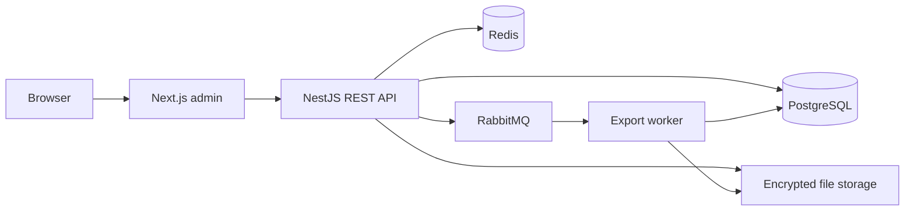

<div align="center">

# ContentDock

### Your content. Every workspace. One platform.

An open-source, multi-tenant headless CMS for publishing content,<br />
managing private media, and collaborating across workspaces.

[](https://github.com/luqelha/atlas-platform/actions/workflows/ci.yml)
[](LICENSE)
[](.node-version)
[](package.json)

[Getting started](#local-development) · [Architecture](#architecture) · [Documentation](#documentation) · [Deployment](#production)

</div>

---

ContentDock brings a responsive administration interface and a REST API into one monorepo. Teams can organize articles, publish content, manage files, and control access in separate workspaces, with an audit trail for administrative activity.

The admin includes light and dark themes, a rich-text editor, and built-in user guides. The backend handles authorization, encrypted media storage, and queued exports.

## Capabilities

| Area                   | What you can do                                                                                                    |
| :--------------------- | :----------------------------------------------------------------------------------------------------------------- |
| **Content publishing** | Write rich-text articles, organize categories, manage drafts, publish, and search paginated content lists.         |
| **Workspaces**         | Create and switch organizations while keeping their content, files, and memberships separate.                      |
| **Team access**        | Invite members through shareable links and assign Admin, Editor, or Viewer roles.                                  |
| **Private media**      | Upload images and PDFs, preview and download authenticated files, and store media encrypted at rest.               |
| **Accounts**           | Register, sign in, manage profiles and avatars, and change passwords with HTTP-only session cookies.               |
| **Audit & exports**    | Filter activity history and request workspace-scoped ZIP exports with background processing and progress tracking. |
| **Operations**         | Inspect health checks, enable Prometheus/Grafana monitoring, and use retention and recovery tooling.               |

## Architecture



Workspace authorization is enforced by the API. Export jobs run asynchronously through RabbitMQ, with durable task records in PostgreSQL. See the [architecture guide](apps/api/docs/ARCHITECTURE.md) for request flows, service boundaries, and deployment topology.

| Layer           | Technologies                                                 |
| :-------------- | :----------------------------------------------------------- |
| **Admin**       | Next.js 16 · React 19 · TypeScript · Tailwind CSS 4 · Tiptap |
| **API**         | NestJS 11 · Prisma 5 · JWT · Swagger / OpenAPI               |
| **Data & jobs** | PostgreSQL 15 · Redis 7 · RabbitMQ 3                         |
| **Development** | npm workspaces · Turborepo · Jest · Playwright               |
| **Deployment**  | Docker Compose · Nginx · optional Caddy TLS                  |

## Local development

### Prerequisites

- **Node.js 24**, matching [`.node-version`](.node-version).
- **npm 10.9.9**, matching the root `packageManager` field.
- **Docker with Compose** for PostgreSQL, Redis, and RabbitMQ.

### 1. Clone and install

```sh
git clone https://github.com/luqelha/atlas-platform.git
cd atlas-platform
npm ci
cp apps/api/.env.example apps/api/.env
cp apps/web-admin/.env.example apps/web-admin/.env.local
```

### 2. Configure authentication

In `apps/api/.env`, set **different** values for `JWT_SECRET` and `JWT_REFRESH_SECRET`, each at least 32 characters long. Run this command separately for each value:

```sh
node -e "console.log(require('node:crypto').randomBytes(32).toString('hex'))"
```

The environment examples already match the local Compose services. The frontend connects to `API_URL=http://localhost:4000/api`.

### 3. Start services and apply migrations

```sh
docker compose up -d
npm run prisma:generate --workspace=@atlas/api
cd apps/api
npx prisma migrate deploy
cd ../..
npm run dev
```

Open **[localhost:3000](http://localhost:3000)**, register an account, and create your first workspace. Invite teammates from **Members**.

| Service             | Address                                                   |
| :------------------ | :-------------------------------------------------------- |
| Admin               | [localhost:3000](http://localhost:3000)                   |
| User guides         | [localhost:3000/docs](http://localhost:3000/docs)         |
| REST API            | [localhost:4000/api](http://localhost:4000/api)           |
| Swagger UI          | [localhost:4000/api/docs](http://localhost:4000/api/docs) |
| RabbitMQ management | [localhost:15672](http://localhost:15672)                 |

<details>
<summary><strong>Windows and startup troubleshooting</strong></summary>

- On PowerShell, use `Copy-Item` instead of `cp` if preferred. Use `npm.cmd` and `npx.cmd` if execution policy blocks their PowerShell wrappers.
- Run the root `npm run dev` once: it starts both applications. If Next.js reports another development server, stop the previous process in its terminal before restarting.
- If `apps/api/dist/main` is missing during production-style startup, run `npm run build --workspace=@atlas/api` before `npm run start:prod --workspace=@atlas/api`. Avoid building the API while its development watcher is running.
- If you change the API port, update the frontend's `API_URL`, retaining the `/api` suffix. Local infrastructure binds to loopback; adjust Compose mappings if ports are occupied.

</details>

The `@atlas/*` workspace names and repository URL are existing internal identifiers. The product is **ContentDock**; use the identifiers shown above when running commands.

## Development & testing

Run commands from the repository root. Both applications share the root `package-lock.json`.

| Command                                              | Purpose                                     |
| :--------------------------------------------------- | :------------------------------------------ |
| `npm run dev`                                        | Start the API and admin in development mode |
| `npm run build`                                      | Build both applications                     |
| `npm run lint`                                       | Lint both workspaces                        |
| `npm run typecheck`                                  | Check application types                     |
| `npm run test --workspace=@atlas/api -- --runInBand` | Run API unit tests                          |
| `npm run test:contracts`                             | Verify API and consumer contracts           |
| `npm run test:security`                              | Run security regression checks              |
| `npm run test:browser`                               | Run Playwright browser tests                |

Integration, API end-to-end, and browser checks use isolated test infrastructure. Follow the [test strategy](apps/api/docs/TEST_STRATEGY.md) for setup. Performance measurements and workload limitations are documented in the [performance report](apps/api/docs/PERFORMANCE_REPORT.md).

## Production

The production Compose stack includes the admin, API, migration service, PostgreSQL, Redis, RabbitMQ, and Nginx. An optional Caddy profile provides TLS.

Before launching:

1. Copy `.env.production.example` to `.env.production` and configure credentials, hostname, and distinct authentication secrets.
2. Set a persistent `STORAGE_ENCRYPTION_KEY` to 64 hexadecimal characters. Back it up alongside the database and encrypted files.
3. Follow [runtime database role provisioning](scripts/database/README.md) to configure the restricted `DATABASE_APP_URL` separately from migration credentials.
4. Review the [release notes](apps/api/docs/RELEASE_NOTES.md), configure DNS, and make ports 80/443 available for TLS.

```sh
docker compose --env-file .env.production -f docker-compose.prod.yml build
docker compose --env-file .env.production -f docker-compose.prod.yml --profile tls up -d
```

Production sessions require HTTPS. Without the TLS profile, Nginx binds to `127.0.0.1:8080` for local inspection. Database and broker ports are not published by the production stack.

For monitoring, backup, recovery, and retention procedures, use the operational guides below.

## Documentation

| Guide                                                                         | Contents                                                  |
| :---------------------------------------------------------------------------- | :-------------------------------------------------------- |
| [Architecture](apps/api/docs/ARCHITECTURE.md)                                 | System boundaries, request flows, and deployment diagrams |
| [API specification](apps/api/docs/API_SPECIFICATION.md)                       | Endpoints and API contracts                               |
| [Security](apps/api/docs/SECURITY.md)                                         | Authentication, authorization, and storage boundaries     |
| [Testing](apps/api/docs/TEST_STRATEGY.md)                                     | Unit, integration, API, and browser validation            |
| [Observability](docs/improvements/phase-4/OBSERVABILITY.md)                   | Metrics, dashboards, and alerting                         |
| [Operational runbooks](docs/improvements/phase-4/OPERATIONAL-RUNBOOKS.md)     | Incidents, resilience, and recovery                       |
| [Maintenance](docs/improvements/phase-4/LONG-TERM-MAINTENANCE.md)             | Dependency lifecycle and ongoing checks                   |
| [Retention](docs/improvements/phase-4/RETENTION-POLICY.md)                    | File retention and cleanup procedures                     |
| [Browser & accessibility](docs/improvements/phase-4/BROWSER-ACCESSIBILITY.md) | Browser coverage and accessibility verification           |
| [Release notes](apps/api/docs/RELEASE_NOTES.md)                               | Upgrade considerations and migration details              |
| [Decision log](apps/api/docs/DECISION_LOG.md)                                 | Technical choices and tradeoffs                           |
| [Development history](DEVELOPMENT.md)                                         | Roadmap and implementation evidence                       |

## Project scope

Invitations use shareable links; automatic invitation emails and password recovery emails are not implemented. Billing, GraphQL, and content revision history are outside the current feature set. Workspace domains are identifiers and do not configure DNS.

Deployment configuration and local verification evidence are included in the repository. Review staging behavior, backup restoration, and your environment before deploying to production.

## Contributing

Keep changes focused and include the relevant checks from the [test strategy](apps/api/docs/TEST_STRATEGY.md). For pull requests, describe the behavior changed and how it was verified.

Commit source, migrations, fixtures, sanitized configuration examples, and documentation. Keep credentials, local environment files, dependencies, and build output out of Git. Historical evidence under `docs/improvements` and curated assets under `artifacts` support linked project reports; new generated reports should use ignored output directories unless deliberately curated.

## License

[MIT](LICENSE) · Copyright © 2026 [luqelha](https://github.com/luqelha)
