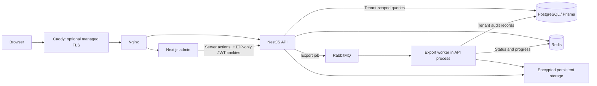

# Fullstack architecture

Atlas is a modular monolith for a B2B, multi-tenant headless CMS. The administrative interface follows an ERP workspace model: persistent navigation, tabular records, contextual actions, explicit permissions, and operational audit history.

## Trust boundaries

- The browser never receives the JWT in JavaScript. Server actions and file routes attach it to backend requests.
- Workspace IDs are selected through a server action that checks current memberships.
- Every tenant resource guard checks current database membership, even without role metadata.
- Tenant IDs in route parameters must match the authorized header context.
- Roles are not cached for authorization; revocations take effect on the next request.
- Personal profile endpoints are self-only. Administrators manage memberships rather than other users' global credentials.
- API content responses select safe author fields rather than returning the whole user model.
- Media is delivered through authenticated file routes, never a public upload directory.

## Authentication and concurrency

Access tokens expire after the configured lifetime. Next.js refreshes near expiry and forwards the refreshed cookie to the current server render. The API serializes refresh operations per user in Redis and shares the rotated result for five seconds to handle concurrent requests. Refresh tokens are SHA-256 digested before bcrypt to avoid bcrypt's 72-byte truncation of long JWTs. Token IDs are random.

Existing sessions from before the digest change need to sign in again. Logout and password changes invalidate refresh tokens; existing access tokens remain valid until their configured expiry.

## Data and background work

Content queries use database pagination, filtering, and search. Tenant cache revisions invalidate all related content/category responses after mutations; old entries expire automatically. The overview uses real database counts and recent content, without sample metrics.

Invitations store only a hash of the link token as their Redis key, expire in seven days, bind acceptance to the recipient's email, and require the inviting administrator to retain access. Redis persistence is enabled in production. No email is sent automatically.

Exports are restricted to the requesting administrator and workspace, have a bounded date range, and stream database records in pages into an encrypted ZIP. Redis status expires after 24 hours. The worker runs with the API process; separate worker deployment is a future scaling choice.

## File storage

New media and avatars use AES-256-GCM. Archives use streaming encryption. Production requires a persistent 64-character hex STORAGE_ENCRYPTION_KEY supplied outside source control. Local development generates a key in the ignored storage directory. Keep a secure backup of this key alongside storage backups; changing it without migrating files makes previous encrypted files unreadable.

Legacy plain uploads remain readable only through authorized routes. Existing avatars with old filenames should be re-uploaded. The editor maps legacy rich-text image sources to the authenticated file route. Public content delivery, object storage, and signed public asset URLs are separate deployment/product decisions.

## Deployment

Production compose includes frontend, backend, a one-shot migration service, PostgreSQL, Redis, RabbitMQ, Nginx, and an optional Caddy TLS profile. Database and message-broker ports are not published. The local proxy binds to 127.0.0.1:8080. The TLS profile requires a real hostname, DNS records, and ports 80/443 to be available.

CI applies migration files to an isolated database, checks lint and builds, runs unit/integration/API/browser tests, retains diagnostic artifacts, and builds both container images. It does not automatically publish a release or deploy to an unspecified server.
