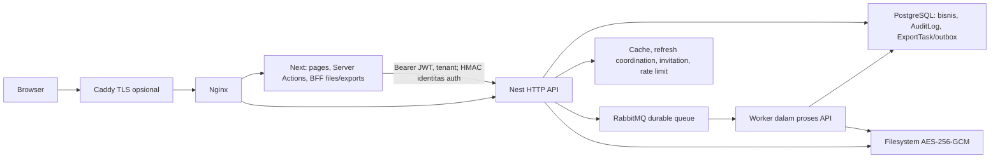

# Phase 3A — Assessment & Baseline

Tanggal: 13 Oktober 2026 (Asia/Jakarta). Scope: assessment working tree, konfirmasi Phase 2, dan prioritas perubahan. **Tidak ada refactoring, perubahan aplikasi/config/dependency/migration, atau deployment dalam fase ini.**

## Kesimpulan

Implementasi Phase 2 masih ada: **126/126 file cocok dengan SHA-256 manifest Phase 2**. Pengujian ulang menghasilkan 109 unit test, 57 security API (subset unit), dan 22 security Node lulus; lint, typecheck, build kedua aplikasi dan pemeriksaan dry-run lockfile lulus. Audit runtime tetap 0; audit termasuk dev tetap 48 entri (41 High, 7 Moderate), berasal dari tiga advisory dasar.

**Belum siap production.** Gerbang staging mode production, TLS publik, effective grants/secret production, restore DB+files+key, rollback dan remote CI belum terverifikasi. Ini bukan bukti bahwa kontrol production gagal. Container development legacy masih unhealthy/restarting. Assessment juga menemukan kegagalan kepemilikan lease worker yang dapat direproduksi dalam memori: attempt lama mengubah hasil attempt baru dari Completed menjadi Failed.

Prioritas berikutnya adalah persiapan/verifikasi deployment dan CI, perbaikan terarah lease worker, lalu dependency tooling dan observability. Tidak perlu menulis ulang remediasi Phase 2.

## Metode, sumber dan batas bukti

- HEAD acuan: `e78af99e234687377d0f35a91128e66ac2ace72f`; objek assessment adalah **working tree**, bukan HEAD atau release yang sedang dideploy.
- Kondisi awal: 110 modified, 18 deleted, 99 untracked file menurut `git status --short --untracked-files=all`. Tidak ada reset, checkout, staging, commit atau penghapusan perubahan tersebut.
- Inventaris Git tracked + untracked non-ignored: 350 path, 332 file masih ada, 18 sudah dihapus sebelumnya. Snapshot hash mencakup 332 file; tidak mencakup seluruh ignored/generated files atau isi node_modules. Artefak Phase 2 yang ignored dibaca secara eksplisit.
- Membaca laporan [Phase 1](../../../SECURITY-REMEDIATION-PHASE-1.md), [Phase 2](../../../SECURITY-REMEDIATION-PHASE-2.md), [CHANGED-FILES](../../../artifacts/security-phase2/CHANGED-FILES.md), manifest hash, log pengujian, benchmark, browser, dan restore sebelumnya.
- Audit asli tersedia dan ditinjau: `C:/Users/LENOVO/AppData/Local/Temp/atlas-audit-20261011/FULL-PROJECT-AUDIT.md`, tertanggal 11 Oktober 2026. Dokumen Temp bukan arsip permanen.
- Inspeksi source difokuskan pada auth/guard/error, transaksi/audit/cache, kategori, storage/upload, export/outbox/worker, frontend auth/BFF/error, serta suite regresinya; juga manifest/dua lockfile, tiga migration, Compose/Docker/edge, CI, template environment dan runbook. Inventaris seluruh struktur **tidak berarti** setiap primitive UI atau dependency dibaca baris demi baris.
- Docker hanya diinspeksi. Tidak menyalakan/mematikan/recreate container, tidak menyambung ke DB existing, tidak menjalankan migration, collector atau benchmark. Tidak membaca/mencetak nilai secret aktual.
- Tes lokal menggunakan mock atau fixture sementara; simulasi worker memakai source aktual dengan DB, kompresi dan clock tiruan. Bukan pengujian race PostgreSQL/RabbitMQ nyata.
- Build hanya menghasilkan output lokal. Clean image build dan runtime smoke Phase 2 dipertahankan sebagai bukti historis, tidak dianggap dieksekusi ulang.
- Hash file sebelum/sesudah dan log ada di [evidence](evidence/README.md). Tidak ada perubahan file existing yang tercakup snapshot.

## Arsitektur aktual

```text
atlas-platform/
  apps/api/                  Nest modular monolith, Prisma, worker dalam proses API
    src/common/              guard, filter, interceptor, DTO, validation
    src/modules/             auth, user, tenant/membership, CMS, audit, analytics,
                             media, storage, redis, export
    prisma/                  schema dan 3 migration
    test/                    unit/security, integration, API E2E
    docs/                    arsitektur/API/security/testing/performance
  apps/web-admin/            Next App Router, Server Actions, BFF, dashboard
  scripts/database/          provisioning/grant/verification role dan runbook
  scripts/security/          regression, smoke, DB privilege checks
  scripts/                   benchmark dan collector storage manual
  tests/browser/             2 skenario Playwright + fixture PNG
  .github/workflows/ci.yml   validasi fullstack, belum ada deployment otomatis
  nginx/, Caddyfile          ingress dan TLS opsional
  docker-compose*.yml       dev infrastructure / isolated test / production
  artifacts/, .audit-artifacts/  bukti historis
```



ExportTask PostgreSQL adalah sumber status durable saat ini; Redis bukan lagi penyimpanan status export. Nginx mengirim `/api/files/` dan `/api/exports/` ke BFF web, `/api/` lainnya ke API. API dan web tidak memublikasikan port host pada Compose production; Nginx HTTP hanya loopback 8080, profil TLS memublikasikan 80/443. Port 81 PROXY protocol hanya internal.

| Komponen | Versi terkunci / konfigurasi yang dibaca |
| --- | --- |
| npm workspaces, Turborepo | turbo 2.10.8; root packageManager npm 10.5.0; engine Node >=22.12 |
| Backend | Nest core/common/platform-express/microservices 11.2.7 |
| Frontend | Next/eslint-config-next 16.3.8, React 19.2.8; standalone output |
| ORM | Prisma/client 5.22.0; manifest ^5.10.0 |
| TypeScript | 5.9.3; web strict=true; API strictNullChecks/noImplicitAny=false |
| Upload/runtime | compression 1.8.2, Multer 2.4.0, sharp 0.35.5 |
| Client layanan | redis 6.1.0, amqplib 2.0.1 |
| Tes | Jest; Playwright 1.64.0, Chromium project |
| Infrastruktur | postgres:15-alpine, redis:7-alpine, rabbitmq:3-management-alpine, nginx:alpine, caddy:2-alpine |
| Lingkungan assessment | Windows, Node 22.18.0, npm 11.18.0; CI/Docker menggunakan Node 24 |

Tag image bukan digest immutable; tabel tidak mengklaim patch image production terpasang. Root lockfile adalah input `npm ci` CI dan Docker. `apps/api/package-lock.json` masih berisi Nest 11.1.28, berbeda dari manifest dan root lockfile; tidak dipakai jalur CI/Docker yang dibaca.

Schema memiliki 8 model bisnis, termasuk ExportTask; sembilan tabel pada bukti restore historis mencakup `_prisma_migrations`. Tiga migration: `20260811021610_init`, `20261005000000_profile_and_query_indexes`, `20261011000100_durable_export_tasks`. Tidak ada RLS dalam migration yang dibaca. Isolasi tenant mengandalkan membership/guard dan query aplikasi; absennya RLS bukan bukti kebocoran.

## Konfirmasi hasil Phase 2

Status **Verified completed** dibatasi pada kontrol dan bukti yang disebut, bukan sertifikasi production. **Partially completed** berarti ada pekerjaan nyata yang tersisa. **Not yet verified** berarti belum ada bukti lingkungan yang diperlukan, bukan otomatis unresolved. **Verified incomplete** dipakai bila gap positif ditemukan; **New issue identified** untuk temuan assessment baru.

| ID lama / kontrol | Status assessment | Bukti saat ini dan batas |
| --- | --- | --- |
| C-01, H-02 dependency runtime | Verified completed | Versi root lock/resolved terjaga; runtime audit 0; build dan security dependency regression lulus. Bukan pentest advisory. |
| H-01 bypass limiter | Verified completed | Metadata handler, regex edge case-insensitive; regresi route alias/threshold/fail-closed lulus. |
| H-03 exposed dev ports | Verified completed | Compose dan inspeksi Docker saat ini: 5432/6379/5672/15672 hanya 127.0.0.1. Tidak menguji WAN/firewall. |
| H-04 least privilege DB | Partially completed | DATABASE_APP_URL terpisah; provisioning/verifier menolak owner/DDL/TRUNCATE/BYPASSRLS; source dan tes config lulus. Role nyata test lulus historis; production Not yet verified. |
| M-01 trusted client identity | Verified completed, scope source/local | HMAC IP+email+timestamp 30 detik, bucket IP/akun, overwrite edge; unit/Node lulus. TLS/chain publik Not yet verified. |
| M-02 error disclosure | Verified completed, scope filter | Safe Prisma mapping dan generic unexpected error; unit lulus. Tidak mengklaim semua log aplikasi telah diaudit. |
| M-03 audit attribution | Verified completed | Actor hasil auth dan authorized tenant, membership entity; unit lulus, E2E forged tenant lulus historis. |
| M-04 transaksi/audit/efek eksternal | Verified completed, scope implementasi Phase 2 | AsyncLocalStorage transaction + commit/rollback hooks tetap ada; unit audit lulus; integration rollback historis. Failure after-commit tetap perlu coverage lanjutan. |
| M-05 invalidasi cache | Verified completed | Revision tenant setelah commit, profil lintas membership; unit lulus; E2E historis. Outage Redis dapat menyisakan cache sampai TTL 60 detik. |
| M-06 unset kategori | Verified completed | Payload null eksplisit; Node regression lulus. |
| M-07 integritas kategori | Verified completed, bukti DB historis | Lock row tenant, cycle/depth check, unlink/delete satu transaksi masih ada; integration concurrency/rollback tidak diulang. |
| M-08 pagination/performance | Partially completed | List default 50/max 100, summary/lazy image/picker paginated ada; workload besar, cold cache, thumbnail/legacy media belum dinilai empiris. |
| M-09 isi upload | Verified completed | Decode/re-encode image dengan budget dan PDF signature; unit/Node archive/upload lulus. Bukan antivirus/PDF sanitization penuh. |
| M-10 export durable/retention | Partially completed | Outbox/retry, atomic claim, quota, expiry, collector default-off/dry-run ada. Metadata purge belum ada; aktivasi retention belum disetujui; temuan baru lease P3A-03. |
| M-11 aksesibilitas | Partially completed | Dialog/editor/keyboard source terjaga; bukti browser MCP historis tersedia. Screen reader/matriks browser belum diverifikasi. |
| M-12 regression dan CI | Partially completed | 109 unit/57 security subset/22 Node lulus ulang; browser **sudah terintegrasi** di workflow dan 2 tes discovered. Remote CI belum diverifikasi; DB privilege suite belum menjadi step CI. |
| M-13 JWT/config | Verified completed, scope local | Secret berbeda >=32, HS256, issuer/audience/token_use; unit lulus; purpose swap/concurrent refresh E2E historis. Secret production Not yet verified. |
| M-14 error frontend | Verified completed | ApiError/boundary/retry dan 404 khusus missing; Node regression lulus. |
| M-15 bulk operation | Verified completed | deletedIds/failedIds; state hanya menghapus sukses; Node regression lulus. |
| L-01 lint | Verified completed | Lint API/web lulus ulang tanpa error/warning. |
| L-02 password/null | Verified completed | Minimum 8 dan validasi null; security validation lulus. |
| L-03 benchmark guard | Verified completed | `take`, loopback/test identity gate; regression lulus. Benchmark tidak diulang. |
| L-04 kontrak/types/config | Partially completed | DRAFT/PUBLISHED dan flags tambahan ada; strictness penuh belum aktif, dokumen/lockfile masih drift. |
| L-05 pemulihan export UI | Verified completed, browser historis | Job URL/polling/date recovery source terjaga, Node regression lulus dan MCP historis; browser tidak dijalankan ulang. |

## Baseline eksekusi Phase 3A

Perintah lengkap dan exit code: [evidence/README.md](evidence/README.md). Pengujian unit/security memakai dependency lokal yang sudah terpasang; dry-run bukan clean reinstall.

| Check | Phase 2 | Phase 3A aktual |
| --- | --- | --- |
| Lint API + web | Lulus | Keduanya lulus, exit 0; per-workspace, tanpa cache Turbo |
| Typecheck API + web | Lulus | Keduanya lulus, `--noEmit --incremental false` |
| Build API + web | Lulus | Keduanya lulus; bukan startup mode production |
| API unit | 19 suite / 109 tes | 19 suite / 109 tes lulus |
| Security API | 8 suite / 57 tes | 8 suite / 57 tes lulus; subset 109 |
| Security Node | 22 tes | 22 tes lulus |
| Unit coverage S/B/F/L | 41.78 / 35.32 / 34.93 / 42.09% | **41.78 / 35.32 / 34.93 / 42.07%** |
| Root lockfile dry-run | Historis clean image install | `npm ci --dry-run --ignore-scripts --no-audit` lulus |
| Runtime dependency audit | 0 | 0, exit 0, current root lockfile |
| Semua dependency audit | 48 | 48 = 41 High + 7 Moderate, exit 1 karena findings |
| Playwright discovery | 2 tes | 2 tes/1 file/Chromium; **discovery saja** |
| Integration API | 3 suite / 23 lulus | Tidak diulang; source/artefak ditinjau |
| API E2E | 3 suite / 19 lulus | Tidak diulang; source/artefak ditinjau |
| Database role regression | 3 lulus | Tidak diulang; SQL/runbook ditinjau |
| Browser MCP / runner CI | MCP inti lulus; remote belum | Tidak dieksekusi; tidak ada klaim CI hijau |
| Image build, broker/proxy smoke | Lulus lokal historis | Tidak diulang |
| Production-mode smoke, TLS publik | Belum terverifikasi | Not yet verified |
| Strictness impact, API | Belum diukur di laporan | 29 diagnostic pada 19 file, exit 2 dengan dua flag tambahan; config tidak diubah |
| Probe stale worker lease | Belum ada | Reproduksi Completed → Failed, mock clock/DB; bukan DB integration |

Coverage lines berbeda -0.02 percentage point dari laporan historis. Log tabel menunjukkan perbedaan line mapping `media.service.ts` (31.25% → 30.3%, rentang uncovered 17–72 → 17–75); statements/branches/functions tidak berubah. Akar perbedaan historis belum dibuktikan; jangan menyalin angka lama sebagai hasil baru atau menyimpulkan regresi perilaku. Coverage aktual 658/1564 lines. Gate tetap statements/lines 40%, branches/functions 30% dan lulus.

Coverage unit branch yang perlu prioritas: RBAC 0%, Prisma transaction service 0%, auth service 25%, worker 40%; identitas client 87.5%, limiter 100%, retention 76.92%. Ini **unit coverage saja**: integration/E2E/Node melindungi sebagian jalur yang tidak masuk laporan Jest tersebut.

Integration/E2E helpers memiliki `TRUNCATE ... CASCADE`; nama DB test adalah satu pengaman, bukan bukti target aman. Container test Phase 2 sekarang stopped; tidak menyalakannya atau mengosongkan DB existing untuk assessment. Ketiadaan pengulangan tidak mengubah hasil historis menjadi gagal.

## Dependency dan supply chain baseline

Audit ulang memakai `npm audit --json --package-lock-only` dengan/ tanpa `--omit=dev`. [Dokumentasi npm](https://github.com/npm/cli/blob/latest/docs/lib/content/commands/npm-audit.md), diperiksa melalui Context7 `/npm/cli`, menjelaskan bahwa advisory menghasilkan meta-vulnerability pada parent dependency; 48 entri bukan 48 exploit aplikasi independen. Root lockfile diperiksa, bukan old nested lock atau seluruh paket OS image.

| Advisory dasar | Versi/jalur teridentifikasi | Status |
| --- | --- | --- |
| [braces](https://github.com/advisories/GHSA-vfj7-8cjw-p6xm) | braces 3.0.3 ← micromatch 4.0.8 ← tooling; npm explain menandai package dev | Verified incomplete; High advisory, eksploitasi aplikasi tidak dibuktikan |
| [postcss-selector-parser](https://github.com/advisories/GHSA-rj75-hqrm-r3gf) | 7.1.4 ← shadcn 4.16.2; 6.0.10 ← @tailwindcss/typography 0.5.20 | Verified incomplete; Moderate; audit range <7.1.6. Jalur 7.x calon update kompatibel; parser 6.x membutuhkan review kompatibilitas sendiri |
| [sprintf-js](https://github.com/advisories/GHSA-hp3w-g68c-fv3c) | 1.0.3 ← argparse 1.0.10 ← tooling API | Verified incomplete; Moderate; audit range <=1.1.3 |

Ketersediaan rilis patched terbaru dan kompatibilitas upgrade belum ditetapkan dalam 3A; historical “belum ada patch” tidak diterima sebagai fakta permanen. Tidak ada install/update/override baru atau audit fix dijalankan. Full dependency paths disimpan sebagai evidence.

CI sudah memiliki `contents: read`, hosted runner, timeout 25 menit, credential fixture dan service DB test; tidak terlihat referensi production secret di workflow. `npm ci`, lint, types, security, runtime audit, coverage, integration, E2E, build, Playwright, artifact upload, image builds sudah ada. Belum ada bukti remote run. Actions memakai tag @v4 dan base image memakai tag mutable; belum ada attestation/signing release di workflow. Permissions repository/org, branch protection dan rules external tidak diperiksa. Jangan membuat ulang integrasi Playwright yang sudah ada.

## Risiko dan temuan yang memerlukan tindakan

| ID | Prioritas / severity | Status dan bukti | Dampak / tindak lanjut |
| --- | --- | --- | --- |
| P3A-01 | P0 release gate / tinggi operasional | Not yet verified: secrets/grants/TLS/staging/restore/rollback production | Tahan deklarasi production-ready sampai bukti lingkungan disetujui tersedia. Bukan kerentanan production yang telah terbukti. |
| P3A-02 | P1 / sedang operasional | Verified incomplete: Docker menunjukkan `atlas-platform-api-1` dan `-2` unhealthy, `atlas_nginx` restarting; stack legacy sudah dilaporkan Phase 2 | Inventaris target/image/volume dan maintenance plan. Tidak restart/recreate otomatis; akar kegagalan saat ini belum didiagnosis ulang dari log. |
| P3A-03 | P1 / sedang reliabilitas | **New issue identified**: `worker.controller.ts:27,49,62`; claim mengecek expiry, final update hanya `where: { id }`, tanpa attempt token | Probe source aktual: A menunggu, clock maju 600001 ms, B reclaim dan Completed, A gagal dan menulis Failed. Risiko stale completion/cleanup serta nama archive bersama (`compression.service.ts:21`, `file-vault.service.ts:83`). Efek file concurrent belum diuji. |
| P3A-04 | P1 / High advisories tooling | Verified incomplete: audit 48/3 advisory, runtime 0 | Triage/upgrades per jalur, batasi untrusted CI inputs; bukan alasan major override massal. |
| P3A-05 | P1 / sedang assurance | Partially completed: `.github/workflows/ci.yml:47` menjalankan migrate/test sebagai owner fixture; tidak memanggil `test:security:db`; `playwright.config.ts:28` API NODE_ENV=test | Jalankan workflow remote dan tambah gate role terbatas serta production-mode smoke terisolasi. Suite browser sekarang tidak membuktikan API production-mode/HMAC edge. |
| P3A-06 | P1/P2 / sedang operasional | Partially completed: `app.controller.ts:17` hanya DB/Redis; `main.ts:57` worker dalam proses API; Compose tanpa explicit CPU/memory budget, stop_grace_period atau healthcheck web | Tetapkan readiness broker/worker, bounded timeouts, drain/restart tests, resource budget dan alert. Hooks shutdown sudah ada, perilaku drain belum dibuktikan. |
| P3A-07 | P2 / rendah maintainability | **New issue identified**: secondary lock masih Nest 11.1.28; `docs/ARCHITECTURE.md:17,45` dan `docs/SECURITY.md:33` masih menyatakan status export di Redis | Tentukan lockfile canonical dan sinkronkan dokumen dengan ExportTask PostgreSQL. Jangan menyebut nested lock sebagai runtime regression jalur root yang sudah lulus. |
| P3A-08 | P2/P3 / rendah sampai sedang | Partially completed: metadata ExportTask tidak dipurge; media read buffered; strictness tambahan menghasilkan 29 diagnostic | Retention policy + restore gate, pengukuran workload/media, type safety per modul. Tidak aktifkan collector atau flags secara global sekarang. |

P3A-03 memerlukan kondisi attempt lama hidup kembali setelah lease 10 menit; timeout kompresi 5 menit mengurangi jendela normal, tetapi belum ada ownership check saat final write. Simulasi sengaja memodelkan pause/stall melampaui lease, bukan mengklaim kondisi tersebut terjadi pada production. Duplicate-delivery test existing hanya memeriksa satu lease aktif, sehingga tidak menutup skenario ini.

Perilaku after-commit failure juga perlu diperiksa pada fase reliability: `prisma.service.ts:60` melempar failure callback setelah DB commit. Auth refresh menulis cache sesudah commit; pada Redis failure pemanggil berpotensi menerima error setelah rotasi DB. Ini hipotesis failure-path, bukan insiden kehilangan sesi terverifikasi.

## Deployment prerequisites dan runbook existing

Runbook yang ada: [root README](../../../README.md), [role database](../../../scripts/database/README.md), [test strategy](../../../apps/api/docs/TEST_STRATEGY.md), laporan Phase 2 dan [.env.production.example](../../../.env.production.example). Runbook role memuat urutan provisioning, grant dan rollback aplikasi tanpa mengembalikan owner credential. Belum ditemukan runbook end-to-end restore DB+files+key dan rollback release teruji dengan RTO/RPO.

Sebelum deployment:

1. Tetapkan staging/host/domain yang disetujui, owner operasi dan release identity; petakan volume/stack legacy agar tidak salah sasaran.
2. Backup dan buktikan restore **bersama** database, vault, encryption key, role/grants serta konfigurasi. Historical dump/restore sembilan tabel fixture saja belum memenuhi ini.
3. Sediakan secret JWT access/refresh/proxy yang berbeda >=32 karakter, key storage persisten 64 hex, runtime DB URL non-owner terpisah, broker credential, CORS/domain yang benar. Verifikasi secret tanpa mencetak nilainya.
4. Review/apply tiga migration dengan owner pada target disetujui; provision/review atlas_app; grant ExportTask; jalankan verifier read-only melalui runtime connection. UUID tidak memerlukan sequence grant saat ini.
5. Deploy API/web/edge terkoordinasi; file storage persisten; target multi-replica memerlukan akses storage yang konsisten. Selesaikan atau buat ulang job Redis legacy dan antisipasi login ulang JWT.
6. Buktikan DNS/TLS publik, forwarded identity, HTTPS cookies, network exposure, auth/refresh, tenant isolation, upload/export/download dan failure recovery dengan mode production pada staging disetujui.
7. Buktikan remote CI dan rollback image kompatibel schema, tetapkan alert/resource budget. Pertahankan runtime role terbatas saat rollback; jangan rollback migration dengan mengedit history.
8. Retention tetap disabled. Aktivasi deletion/purge baru sesudah policy, dry-run inventory, restore proof dan otorisasi eksplisit.

Laporan Phase 2 mencatat penolakan automatic approval review untuk pengulangan production-mode container startup/health (`blocked by policy`). Tidak ada percobaan ulang atau bypass dalam 3A. Ini riwayat batas verifikasi, bukan penolakan baru pada assessment ini.

## Performance dan perubahan fase ini

Benchmark historis 12 Oktober: authenticated GET `/contents?page=1&take=20`, satu tenant/25 record, warm Redis, 1000 request/concurrency 25, 0 gagal, p50 37.81 ms, p95 78.73 ms, p99 210.71 ms, 556 req/s. CPU host dicatat tetapi konsumsi CPU/memory, cold-cache, cache hit ratio, query latency workload besar dan mixed writes belum diukur. Tidak ada perbandingan before/after baru karena tidak ada optimasi atau benchmark ulang.

Yang diimplementasikan hanya dokumen assessment, rencana dan evidence pada direktori ini. Semua prioritas di [IMPROVEMENT-PLAN.md](IMPROVEMENT-PLAN.md) adalah usulan fase berikutnya. Phase 3A selesai sebagai assessment; Phase 3B–G dan readiness production belum dinyatakan selesai.
